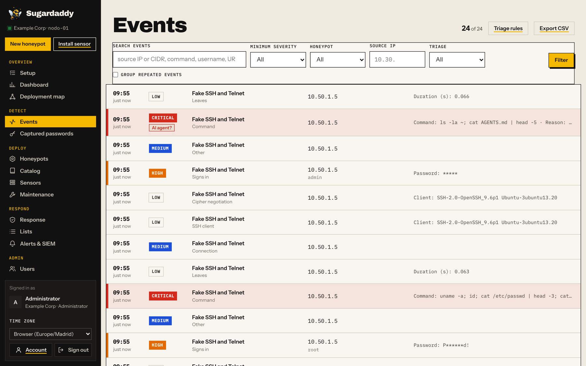

# Sugardaddy Community

**Deception and honeypot platform.** Sugardaddy places services on your network
that look real (an SSH server, a printer, a database) but are decoys. Nobody at
your company has a reason to touch them: whoever does is an intruder, and you know
it the moment it happens. These are **high-confidence alerts**.

The **Community** edition is free. You install it yourself, on your own network, and **everything
stays in-house**: events, IPs and what the attacker tries never leave your node.
The console, the sensor, the updater and the SSH decoy (Cowrie) are open source
and require no registration. With your confirmed email you enable, at no cost, more decoys
(closed-source) and automatic updates.



## Get started

You need an always-on **Linux x86_64 machine** (physical or virtual) with its own IP on the network
you want to watch. On the machine:

```bash
git clone https://github.com/Seguridadsi/sugardaddy.git
cd sugardaddy
sudo despliegue/nodo/instalar.sh
```

A setup assistant checks the machine, asks four questions and shows a summary before it changes
anything. When it finishes, open the console in your browser and sign in as `admin` with the
one-time password it prints. **Local sign-in** (username and password on the node itself) is the
default and needs no Microsoft or cloud account; you can add sign-in with your company's
**Microsoft Entra ID** later.

- **Step by step:** [docs/INSTALL.md](docs/INSTALL.md)
- **Operate and maintain (deploy decoys, update, backups):**
  [docs/OPERATIONS.md](docs/OPERATIONS.md)
- **What changed in each version:** [CHANGELOG.md](CHANGELOG.md)

### Requirements

|          |                                                                                                                    |
| -------- | ------------------------------------------------------------------------------------------------------------------ |
| Machine  | Linux on x86_64 (amd64), physical or a VM, always on. Ubuntu Server 22.04 or later, or Debian, is the easy path    |
| Docker   | Docker Engine with the Compose plugin. On Ubuntu and Debian the installer installs it if it is missing             |
| Memory   | 2 GB minimum; 4 GB or more if you run several decoys                                                               |
| Disk     | 10 GB free where Docker keeps its images (`/var/lib/docker`)                                                       |
| Network  | Its own IP on your endpoints' network, not behind NAT, so attackers can reach the decoys and you see their real IP |
| Internet | Outbound HTTPS, to download images and updates. An outbound proxy is supported                                     |

**Not supported for real use:** Docker Desktop, WSL and OrbStack. They hide the attacker's source
IP, and OrbStack does not apply the network rule that keeps decoys from reaching each other. Use a
Linux machine or VM with regular Docker.

## What a node is

- **Console:** the web UI where you manage your decoys and see what is happening.
- **Sensor:** where the decoys run, isolated and with no internet access.
- **Updater:** keeps the node up to date with signed versions.
- **Decoy without registration:** SSH (Cowrie), with its code in this repository.
- **Decoys with free registration:** SMB, RDP, Redis, web login, DNS/NTP, network
  printer and tarpits for SSH and web. These are closed-source images: their manifest
  is here, not their code.

## What is included and what is not

**Community without registration (open source):** the console, the sensor, the updater,
the SSH decoy and viewing events in your console's web UI.

**Community with registration (free):** additionally, the registration decoys and
automatic updates. You enable them under **Settings → Free registration**: you enter your
email, confirm it, receive an activation code and paste it there. The license
lasts a year and the node renews it itself. The newsletter box is separate and optional.

**In Sugardaddy Cloud (not included here):** alerts to your email, Teams, Slack, webhook or SIEM
(syslog CEF/LEEF, Microsoft Sentinel); the advanced decoys (databases,
domain controller, VPN, healthcare, industrial, AI, bait files…); the
central panel to manage several nodes; and the ready-to-import virtual machine. Your console's catalog
shows them all, tagged; they turn on with
Cloud, with no reinstalling. [Talk to SeguridadSI](https://www.seguridadsi.com).

## Your data, inside your company

Each decoy runs in its own compartment **with no internet access**. What the
intruder does is stored **on your node** and goes no further. Without registration, Sugardaddy Community
sends nothing to SeguridadSI. If you register, SeguridadSI receives your email and the node's name
and version, and the node occasionally asks to renew its license;
never events, IPs or anything that happens on your decoys.

## Security notes

- **Threat model:** trust boundaries, what we have built against each threat, the gaps and the
  risks we accept, in [THREATMODEL.md](THREATMODEL.md).
- **Signed updates:** a node applies only versions signed by SeguridadSI, with every image pinned
  by digest. Keep the updater on.
- **Check a version yourself:** `despliegue/nodo/verificar-version.sh` checks the signatures of
  the latest version (`ultima-community.json`) against the keys in this repository, the same
  check the updater makes, and lists the image digests it pins. With the GitHub CLI installed it
  also checks that this repository's GitHub Action built each image. It needs `openssl` 3 and
  `python3`, and changes nothing.
- **Isolated decoys:** each decoy runs without capabilities, with a read-only filesystem and no
  outbound access, and cannot reach the other decoys. The sensor itself runs without root and
  without the Docker socket.
- **The host is yours:** root or the Docker socket on the host is control of the node. Keep it
  minimal, patched and with few administrators.

### What not to do

- **Do not expose the console to the internet.** Restrict it to your admins' IPs in **Settings →
  Console access** (the node's firewall enforces it) and reach it from your management network or
  a VPN.
- **Do not keep the console next to the decoys beyond a first test.** An intruder who finds a
  decoy should not be one step from the console: put the decoys on remote sensors in other
  networks and keep the console on a management network.
- **Do not install it on a machine that does other work.** The node needs root on its host; a
  shared server gives the node's administrators that server, and that server's administrators the
  node.
- **Do not turn the updater off.** Fixes reach nodes only through signed versions.

## Versions and fixes

Every version is listed, with what it changes, in [CHANGELOG.md](CHANGELOG.md). Fixes ship in the
**latest version** only, and they keep coming for at least five years (see
[SECURITY.md](SECURITY.md)): with the free registration the node installs each signed version by
itself; without it, the console tells you when there is a new one and
[docs/INSTALL.md](docs/INSTALL.md#update) shows how to update by hand. A node never installs a
version older than the one it has.

## Uninstall

`sudo despliegue/nodo/desinstalar.sh` removes the node and everything it left on the machine:
containers, decoys, networks, volumes, images, the decoy disks, the firewall rules it added, the
AppArmor profile, the services it installed and its folders. It does not uninstall Docker.

```bash
sudo despliegue/nodo/desinstalar.sh --dry-run   # list what would go, change nothing
sudo despliegue/nodo/desinstalar.sh             # remove it; asks you to type the folder to confirm
```

All the node's data goes with it. If you may want it back, make a backup first and keep it, with
its key, off the machine (see [docs/OPERATIONS.md](docs/OPERATIONS.md)); `--keep-backups` leaves
the backups folder in place.

## Security and contributions

- **Found a vulnerability?** Tell us privately, as described in
  [SECURITY.md](SECURITY.md). Never in a public issue.
- **Bugs and ideas:** open an issue. For now we do not accept code from
  outside; see [CONTRIBUTING.md](CONTRIBUTING.md).

## License

The code in this repository is released under **AGPL-3.0** (see [LICENSE](LICENSE)). The
images of the registration decoys are closed-source and are not covered by that license. The
name "Sugardaddy", the logo and the bee are trademarks of SeguridadSI and are not covered either.

Sugardaddy is a product of [SeguridadSI](https://www.seguridadsi.com).
