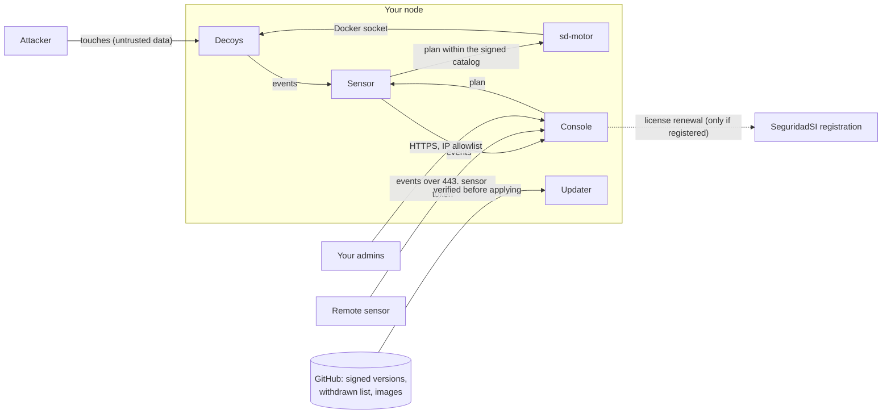

# Threat model: Sugardaddy Community

What we protect, what we trust, how we could be attacked and what we have, and have not, built
against it. For how to report a vulnerability, see [SECURITY.md](SECURITY.md).

This document covers what runs on **your** machines when you install Sugardaddy Community: the
console, the sensor, the updater, the decoys and the remote sensor, plus the two things they talk
to outside your network (the update channel and, if you register, SeguridadSI's registration
service). The services that SeguridadSI operates for Sugardaddy Cloud (central panel, identity,
beacon relay, shared threat intelligence) have their own threat model, available to customers
under NDA.

Each threat lists its mitigations with one of three labels:

- **Implemented:** in the published code and on by default.
- **Partial:** exists, but with limits we state.
- **Gap:** not built yet.

---

## 1. System overview

| Component          | Where it runs                                 | What it does                                                                                                            |
| ------------------ | --------------------------------------------- | ----------------------------------------------------------------------------------------------------------------------- |
| **Decoys**         | Containers on the node or on a remote sensor  | Look like real services (SSH, SMB, RDP, web…). Everything that reaches them is attacker-controlled.                     |
| **Sensor**         | Node and remote sensors                       | Starts the decoys the console asks for and collects their events.                                                       |
| **sd-motor**       | Node and remote sensors, no network           | The only process that talks to Docker on the sensor's behalf.                                                           |
| **Console**        | Node, behind its own HTTPS                    | Web UI, events, decoy configuration. Stores its data in a local Postgres.                                               |
| **Updater**        | Node and remote sensors                       | Applies new versions, only when they carry a valid signature.                                                           |
| **Update channel** | GitHub (public repository and ghcr.io images) | Publishes signed versions and the list of withdrawn images.                                                             |
| **Registration**   | SeguridadSI, only if you register             | Issues the free license for the registration decoys. Receives your email and the node's name and version, never events. |

---

## 2. Trust boundaries and assumptions

### 2.1 Everything a decoy receives is hostile

Decoys exist to be attacked. Every byte that reaches them, and every field of the events they
produce (usernames, passwords, commands, HTTP headers, file names), is attacker-controlled.

- **Assumption:** a decoy can be compromised. Its isolation, not its code, is the security
  boundary.
- **What we do with it:** the console separates what the connection **proves** (source IP and
  port of a real TCP connection) from what the attacker **says** (claimed hostnames, usernames,
  payload contents), and shows the second kind as untrusted. Event fields are escaped on display
  and capped in size.

### 2.2 The signing key is the root of trust

A node applies a version, a decoy catalog or a withdrawn-images list only if it is signed with
SeguridadSI's publication keys. The public keys are built into the installer, which is published
with its checksum in this repository and in the public documentation, not served by any panel.

- **Assumption:** whoever holds a valid publication key can ship code to every node. That is why
  the keys are split by use, can be rotated by a signed version, and live outside the
  infrastructure that serves the product (see T1).

### 2.3 The console is trusted by the sensor, but only inside the signed catalog

The sensor starts what the console asks for, but only decoys that appear in the signed catalog,
with the isolation the catalog fixes. A manifest cannot ask for more privileges than the sensor
allows.

- **Assumption:** the console may be compromised (it is reachable on your network). A compromised
  console must not be able to start arbitrary containers.

### 2.4 The host belongs to you

The node runs on a machine you administer. We harden what we ship; we do not control the host's
operating system, other software on it or who has root.

- **Assumption:** anyone with root or the Docker socket on the host controls the node. That is a
  host-security failure, outside what Sugardaddy can enforce (see Risk-01).

---

## 3. Threat analysis

### T1: Malicious update or supply-chain compromise

**Attacker capability:** tampers with an image in the registry, pushes a modified version, or
steals a signing key.

**Impact:** attacker code running on every node that updates.

- **Implemented:**
  - Versions are signed (Ed25519) and pin every image by **digest**, never by tag. A swapped image
    in the registry is not installed.
  - Separate keys per use (versions, catalog, licenses, withdrawn list). The set of valid keys
    travels inside the signed version, so a key can be rotated or retired by publishing.
  - The updater refuses to go back to an older version than the one installed.
  - A version that changes the node's configuration (compose file, web server, new environment
    variables) or the keys it trusts needs signatures from **two different trusted keys**: a single
    stolen key can swap images, which the next version undoes, but not take over the node.
  - The customer decides when a version is installed (automatic, manual approval, minimum delay
    and an update window in their time zone), enforced by the updater on their machine, with a
    floor in its `.env` that neither the console nor the Central can lower.
  - A signed list of withdrawn images, published in this repository, stops a known-bad image from
    being installed or kept running.
  - The installer is verified with keys embedded in it and a checksum published outside the
    update channel.
  - Community images are built from this repository by a public GitHub Action, with provenance.
- **Partial:**
  - **Anti-freeze timestamp** (a short-lived signed statement of the latest version, so nobody can
    keep a node on an old, vulnerable release) and a **transparency log** of everything signed
    (the node checks an inclusion proof): the node verifies both; the signing service that issues
    them is being rolled out.
  - **Offline root** (two hardware keys, with a threshold, that sign which working keys are
    valid): the format is in the code; the keys are not yet in use.
- **Accepted:** builds are not bit-for-bit reproducible (see Risk-05).

### T2: Escape from a decoy to the host

**Attacker capability:** gets code execution inside a decoy and tries to reach the sensor, the
console, other decoys or the machine.

**Impact:** control of the node and a foothold in your network.

- **Implemented:**
  - Every decoy: `cap_drop: ALL`, `no-new-privileges`, read-only root filesystem, our own seccomp
    profile, its own bounded disk, and a network **with no outbound access** to the internet or to
    the rest of the node.
  - The isolation ceiling is set by the sensor, not by the decoy's manifest.
  - Decoys cannot reach each other: their bridge is created without inter-container traffic, and
    `sd-motor` refuses any other kind of decoy bridge. The sensor does not assume it works: every
    hour it starts two throwaway containers on each decoy network and checks that one cannot reach
    the other; if it can (some Docker engines do not apply the rule), every decoy on that network
    shows a warning.
  - The sensor runs as a non-root user and **does not** mount the Docker socket. Only `sd-motor`
    (no network, reachable only over a Unix socket shared with the sensor) and the updater (which
    applies nothing that is not signed) touch Docker.
  - We keep a table of every container's privileges generated from the code; our CI fails if the
    table and the code disagree. Customers can ask for it.
- **Partial:**
  - gVisor (a user-space kernel between the decoy and the host) is used on the Sugardaddy
    appliance; on a regular Docker install it is used only if the host has it.
- **By design:** decoys with their own IP on your network (used to detect spoofing and scans)
  sit on that segment like any other machine, so they can reach it and each other. They have no
  route to the internet and cannot reach the node itself.
- **Accepted:** `sd-motor` and the updater keep the Docker socket (see Risk-06).

### T3: Compromised console used to start arbitrary containers

**Attacker capability:** takes over the console (web vulnerability, stolen admin session).

**Impact:** events tampered with or deleted; containers of the attacker's choosing on every
sensor.

- **Implemented:**
  - The sensor runs only decoys from the signed catalog, with the isolation the catalog fixes (T2).
  - Console access restricted to an IP allowlist, enforced on the node's firewall, not only in the
    application.
  - Strict CSP, per-action permissions, rate limits on login.
  - Secrets stored by the console are encrypted (AES-GCM).
  - Tamper-evident audit log: a hash chain in the database where rows cannot be updated or deleted,
    only purged by age.
- **Gap:**
  - The console runs on the same machine as the decoys by default (see Risk-02).

### T4: Recognising the decoys (fingerprinting)

**Attacker capability:** compares responses with this public code, or with another installation,
to tell a decoy from a real service.

**Impact:** the attacker avoids the decoys and the deception loses its value, in every
installation at once.

- **Implemented:**
  - Fixes for each known giveaway we find (console banner on the decoys' IP, identifiers,
    certificates, Cowrie defaults).
  - Names generated from your company's domain; per-installation seeds in some decoys.
- **Partial:**
  - Variability per installation exists in some decoys, not as a rule that every decoy must
    follow.
- **Accepted:** no general per-installation variability and no automatic anti-fingerprint test
  (see Risk-03).

### T5: Forged or replayed events

**Attacker capability:** injects fake events, or floods a sensor to bury a real attack.

**Impact:** false alerts, or a real intrusion missed in the noise.

- **Implemented:**
  - Remote sensors authenticate to the console with their own token and their own client
    certificate (mTLS), over HTTPS pinned to the console's CA. Certificates last 90 days, renew
    themselves and can be revoked from the console; once a sensor has used its certificate, its
    token alone no longer gets in.
  - Token rotation is verified: the new token replaces the old one only when the sensor arrives
    with it.
  - Bounded queues; events that do not fit go to quarantine and never block delivery. Events
    with a real TCP connection have their own quota, so noise cannot crowd them out.
  - A malformed event is discarded on its own without stopping the rest of the batch.
- **Partial:**
  - By default, a sensor that has never presented its certificate (one installed before mTLS,
    until it updates) still gets in with its token alone. **Settings → Sensor certificates →
    Policy → require** closes that.

### T6: Data leaving your network

**Attacker capability:** abuses the product to get event data out of your network, or SeguridadSI
receives more than it should.

**Impact:** exposure of what the decoys captured (which can include real passwords typed by
employees).

- **Implemented:**
  - Decoys have no outbound access.
  - Without registration, the node sends nothing to SeguridadSI. With registration, it sends your
    email, the node's name and version, and license renewals. Never events, IPs or captures. The
    exact flows, and the code each one comes from, are in the public documentation.
  - Behind a corporate proxy, the node uses a short, documented list of outbound destinations.
  - Captured credentials (passwords, hashes, tokens) are stored in full, so that you can see what
    was tried, but never in clear: the event keeps a masked copy (`P*****d1`), and the real value
    sits in an AES-256-GCM envelope with its own derived key, bound to that event. Revealing it
    needs its own permission and is written to the audit log. Alerts and webhooks send only the
    masked value unless you mark them otherwise.
  - Captured credentials have their own retention period, 90 days by default and never longer than
    the events. After it, the encrypted value is deleted and only the masked one stays.

### T7: Known vulnerability in a third-party component

**Attacker capability:** exploits a published vulnerability in a library, toolchain or base image
that Sugardaddy ships (an npm package in the console, a Go module in a decoy, the web server in
front of the console).

**Impact:** depends on the component; in a decoy, the sensor or the console it can mean code
execution on the node. Unlike T1, nobody has to tamper with anything: the vulnerable code was
signed and shipped by us.

- **Implemented:**
  - Every dependency is pinned: lockfiles and `go.sum`, base and third-party images by digest,
    GitHub Actions by commit. Nothing changes between builds unless we change it.
  - Decoys are our own Go code and almost all are built `FROM scratch`: no operating system,
    shell or package manager inside, only the binary.
  - Every published image carries a signed CycloneDX **SBOM** and SLSA provenance; a version is not
    signed without them. You can download and check them with `cosign`.
  - Nightly scans: govulncheck, `npm audit` and osv-scanner on every dependency file in the
    repository, and trivy on every published image. A critical issue with a fix fails the build.
  - Exceptions (no fix yet, or the fix is only in a major version) are listed with their reason and
    a review date of at most 90 days; after that date the scan fails again.
  - Fix deadlines, counted until a signed version with the fix is published: **7 days** for
    critical or actively exploited issues, **30** for high, **90** for medium (see
    [SECURITY.md](SECURITY.md)). Severity is never lowered for components that receive attacker
    traffic: decoys, sensor, beacon relay, console login.
  - Fixes reach nodes through the signed update channel (T1), tested end to end and on a test ring
    before the rest.
  - Update pull requests are opened automatically every week, never for a release younger than 7
    days (against freshly poisoned packages), and GitHub vulnerability alerts are on.
- **Partial:**
  - SBOMs are available through the registry, not yet as a plain download.
  - The node's third-party images (web server, database) are still pulled from Docker Hub by
    digest, not from our own registry.
- **Your part:** keep automatic updates on, or set a short window. A node that never updates keeps
  every vulnerability it had.

---

## 4. Risk register (accepted risks)

### Risk-01: Root on the host is root on the node

Anyone with root or with access to the Docker socket on the host can stop, change or read the
node, regardless of signatures. Sugardaddy's controls protect what it installs, not a host that
is already compromised. Keep the host minimal, patched and administered by few people, or use the
appliance, which has no shell or SSH accounts.

### Risk-02: Console and decoys on the same machine

By default the console runs on the same machine as the decoys, so an attacker who sees a decoy is
close to the console. We accept it so that a small company can start with one machine. Mitigated
by the IP allowlist (T3) and the decoy isolation (T2). **Recommended:** put the decoys on remote
sensors in other networks and keep the console on a management network.

### Risk-03: The code is public

Community is open source, so an attacker can read how each decoy responds. We accept it in
exchange for anyone being able to audit the code. Mitigated as described in T4: each giveaway is
fixed when it is found. We do not make every decoy vary per installation, and we do not run public
honeypot detectors against every decoy as a release gate.

### Risk-04: Installation command in shell history

The command that installs a remote sensor carries a one-time enrolment code, visible briefly in
`ps` and in the shell history. It is single-use and expires; once used, it is worthless.

### Risk-05: Builds are not bit-for-bit reproducible

You can build every open-source image from this repository, but you will not get the same digest
as the published one, so you cannot prove they match. What you can check is that each image is
built from a public commit by a public GitHub Action, with provenance, and signed.

### Risk-06: Two node services keep the Docker socket

`sd-motor` and the updater run as root with the Docker socket, which is equivalent to root on the
host. Neither is reachable from a decoy: `sd-motor` has no network, only answers the sensor over a
Unix socket and refuses anything outside the signed catalog and its isolation; the updater only
applies signed versions and receives nothing from the decoys. Getting root through them would take
a decoy escape, then the sensor (which has neither root nor the socket), then a flaw in `sd-motor`'s
filter. Rootless Docker would not remove root from the machine (the decoy firewall, AppArmor and
disk setup still need it), so we do not plan it.

---

## 5. Core security principles

1. **The signature decides.** A node runs what SeguridadSI has signed and nothing else: not what a
   panel, a console or a registry says.
2. **Every input is hostile.** Traffic to decoys, event contents, decoy manifests and data from
   remote sensors are validated as attacker-controlled.
3. **Isolation is the boundary.** We assume decoys will be broken into and design so that it does
   not matter.
4. **Least privilege, written down.** Every container's privileges are generated from the code and
   checked by the CI.
5. **Your data stays with you.** Events never leave your node unless you send them somewhere.
6. **Say what is missing.** Gaps are listed here until they are closed.
